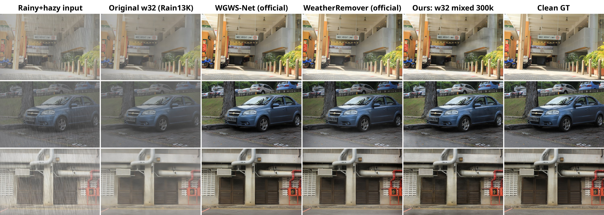

# LightDerainNet: A Single Lightweight Model for Real-Time Rain and Haze Removal

**Technical report and reference implementation** · University capstone project (GPU-accelerated adverse-weather image restoration)

[Abstract](#abstract) · [1 Introduction](#1-introduction) · [2 Method](#2-method) · [3 Experimental setup](#3-experimental-setup) · [4 Results](#4-results) · [5 Limitations](#5-limitations) · [6 Reproducibility](#6-reproducibility) · [References](#references) · [Citation](#citation)

## Abstract

Rain and haze often occur together in the scenes seen by autonomous vehicles and edge devices, yet most restoration networks are either large Transformer/diffusion models (tens of millions of parameters, hundreds of milliseconds per frame) or specialize in a single degradation. We present **LightDerainNet**, a 0.55M-parameter, non-GAN, U-shaped residual CNN that predicts the rain/haze layer at half resolution and removes both degradations with one model. Trained on a mixture of Rain13K and Outdoor-Rain, it processes a 720p frame in **8.2 ms** (FP16, NVIDIA GB10), about 130-140x faster and 14-44x smaller than WGWS-Net and WeatherRemover. On rain+haze images it improves downstream detection (YOLO11s, mAP50 relative to detection on clean images) from 0.395 to **0.858**, and it remains usable on rain-only benchmarks (Rain100L 31.10 dB, Rain100H 26.94 dB), where specialist large models are strong only on their home test set. We also report a negative result: the model has no pure-dehazing ability on RESIDE-6K, which we trace to the absence of atmospheric-scattering haze in the training data.

## 1 Introduction

Adverse weather degrades perception: rain streaks occlude detail, haze lowers contrast, and both break downstream detection. Deployment on vehicles and edge devices requires models that are **small** and **real-time**. Existing multi-weather restorers [10, 9, 11] reach high quality but cost 7-38M parameters and, on our hardware, 54-1127 ms per 720p frame; deraining and dehazing are usually separate models [7, 12], so cascading them doubles latency.

Contributions:

1. **LightDerainNet**, a 0.55M-parameter residual CNN that handles rain, haze and rain+haze with one forward pass (Section 2).
2. A **mixed-data training recipe** (Rain13K + Outdoor-Rain, 22,711 pairs) that avoids the single-domain failure modes we measured (Section 4.2).
3. A **same-machine, same-metric comparison** with Restormer, TransWeather, WGWS-Net, WeatherRemover, AOD-Net and UCL-Dehaze, including a downstream-detection metric (Section 4.1) and cascade baselines (Section 4.3).
4. An honest account of **where the model fails** (pure haze, Section 5) and of the threats to validity of the comparison.

## 2 Method


LightDerainNet (`derain/models.py`) is a U-shaped residual CNN with no attention or Transformer blocks:

- **Resolution reduction.** `PixelUnshuffle x2` maps `3xHxW` to `12xH/2xW/2`, so all convolutions run at half resolution (about 1/4 of the compute); `PixelShuffle x2` restores the output. A strided convolution reaches 1/4 resolution for the bottleneck.
- **Residual learning.** The network predicts the weather layer `R` and outputs `B = x - R`, the usual formulation in deraining CNNs [4, 6].
- **Blocks.** Standard residual blocks [2] (Conv3x3-ReLU-Conv3x3 + identity), 2 in the encoder, 6 in the bottleneck (width 2w), 2 in the decoder, with one skip connection as in U-Net [1]. About 80% of the 0.55M parameters sit in the bottleneck.
- **Scalability.** Width `w` and depth are adjustable; `w16` (140K parameters) is trained with optional knowledge distillation from `w32` [5] for structural-compression experiments.
- **Loss.** `L1 + 0.1 (1 - SSIM)`; mixed precision optional (`--amp`).

The components are standard; the contribution is their combination for the real-time constraint, not a new building block.

## 3 Experimental setup

| Item | Setting |
|---|---|
| Training data | **Mixed**: Rain13K [15] + Outdoor-Rain [16] (22,711 pairs); baselines: Rain13K only, Outdoor-Rain only |
| Schedule | 300k iterations, batch 16, patch 128, lr 2e-4 cosine; seed 0 |
| Rain test sets | Rain100L/H [13] (rain only); Outdoor-Rain Test1 [16] (750 images, rain+haze) |
| Haze test set | RESIDE-6K test [17] (848 pairs, synthetic haze) |
| Quality metrics | PSNR/SSIM on Y channel, 8-bit quantized [18] |
| Task metric | Downstream detection mAP50 with YOLO11s [19] on pseudo-labels from clean images (relative metric) |
| Latency | 720p, batch 1, FP16, one machine (NVIDIA GB10) for all models; WGWS-Net FP32-only |

Full definitions and the threats to validity are in [docs/protocol.md](docs/protocol.md).

## 4 Results

### 4.1 Comparison with large rain and rain+haze models

Official weights unless marked. **Training data differ between rows**, so the differences mix architecture and data distribution (Section 5).

| Model | Params | 720p latency | Outdoor-Rain mAP50 / PSNR / SSIM | Rain100L PSNR | Rain100H PSNR |
|---|---|---|---|---|---|
| WGWS-Net Setting1 [10] | 7.58M | 1127 ms (FP32) | **0.940** / 30.60 / 0.932 | 23.64 | 14.94 |
| WeatherRemover (outdoor_rain) [11] | 24.3M | 1094 ms | **0.953** / 24.99 / 0.909 | 23.20 | 20.87 |
| Restormer (Rain13K) [8] | 26.1M | 1010 ms | 0.728 / 15.14 / 0.637 | **39.08** | **31.47** |
| TransWeather, retrained on our mixed data (100k) [9] | 38.1M | 54 ms | 0.789 / 25.56 / 0.850 | 28.93 | 25.35 |
| **LightDerainNet w32, mixed 300k (ours)** | **0.55M** | **8.2 ms** | 0.858 / 27.64 / 0.890 | 31.10 | 26.94 |

(Machine-readable: [results/main_results.csv](results/main_results.csv).)

- Each large model wins on its home test set but only there: Restormer reaches 15.14 dB on rain+haze, WGWS-Net 14.94 dB on heavy rain, WeatherRemover is 8 dB below ours on Rain100L. LightDerainNet is usable on all three.
- Against TransWeather retrained on identical data, ours uses 1/69 of the parameters, runs about 6.6x faster, with equal mAP50 and slightly better PSNR.



### 4.2 Why mixed-data training

| Training data (w32) | Outdoor-Rain PSNR | Rain100L PSNR | Outdoor-Rain mAP50 |
|---|---|---|---|
| Rain13K only | 15.15 (input 14.46) | 32.32 | 0.395 (rainy input) |
| Outdoor-Rain only (100k) | 27.33 | 20.44 (worse than input) | n/a |
| **Rain13K + Outdoor-Rain (300k)** | 27.64 | 31.10 | **0.858** (recall 0.831) |

A single-domain model fails on the other domain; the mixture covers both. `w48` matched `w32` in quality at 16.7 ms and was not adopted.

### 4.3 Cascades and rain-only baseline

- **Cascades are worse and slower.** Deraining (w32/w16) followed by AOD-Net or UCL-Dehaze reaches mAP50 0.727 / 0.690 vs 0.858 for the single model; cascading UCL-Dehaze (GAN) is also about 24x slower (199 ms vs 8.2 ms).
- **Rain-only baseline** (Rain13K, w32, 100k iterations, about 31 minutes): above 30 dB on Rain100L, Test1200 and Test2800; below on Rain100H and Test100. SSIM: 0.940 / 0.847 / 0.863 / 0.901 / 0.926 (Rain100L / Rain100H / Test100 / Test1200 / Test2800).
- **GPU acceleration** without changing the model takes 720p from about 300 ms on CPU to single-digit milliseconds (FP16, cuDNN); PSNR changes by less than 0.002 dB.
- **Compression** (side experiment): `w16` has 1/4 of the parameters and 1/3.9 of the GFLOPs; PSNR drops 0.2-2 dB, and distillation from `w32` helps mainly on Rain100L (+0.4 dB).

## 5 Limitations

- **No pure-haze ability.** On RESIDE-6K (input 14.92 dB / 0.818) the model scores 14.47 dB / 0.783, 0.5 dB *below* the input and about 6.7 dB below AOD-Net (21.13) and UCL-Dehaze (21.32). On rain+haze those models are far behind (mAP50 0.407 / 0.384 vs 0.858) because they do not remove streaks ([results/haze_results.csv](results/haze_results.csv)). We hypothesize, but have not verified, that the training haze is the thin haze attached to rainy scenes rather than atmospheric-scattering haze.
- **Unequal training data** across the official-weight baselines; only TransWeather and our models share data. A converged same-data comparison of all baselines is not yet available (30k-iteration retraining was discarded because the large models had not converged).
- **Relative detection metric** based on pseudo-labels from a detector; not an absolute accuracy against human annotations.
- Single seed; no confidence intervals.

## 6 Reproducibility

- Install, dataset download, commands for every experiment: [REPRODUCE.md](REPRODUCE.md).
- Measurement rules and metric definitions: [docs/protocol.md](docs/protocol.md).
- Every run appends to `results/*.jsonl` with hardware and software versions.
- Datasets, weights and third-party code are **not** included. Rain13K comes from an unofficial Hugging Face mirror (license unknown): academic use only, cite the original papers. External models are loaded from their official repositories.

```
derain/        model, data, metrics, training, evaluation, benchmark, video pipeline, ONNX export
tools/         downstream detection, external-model comparison, haze/cascade evaluation, figures
docs/          architecture diagram, comparison figure, evaluation protocol
results/       result tables (CSV)
```

**Roadmap:** add pure-haze data (RESIDE-6K train) and re-test on RESIDE-6K; converged same-data retraining of Restormer and WGWS-Net; end-to-end video latency, TensorRT FP16/INT8, a low-end GPU (RTX 3050 4 GB), DRSformer, multi-seed distillation.

## References

[1] O. Ronneberger, P. Fischer, T. Brox. U-Net: Convolutional Networks for Biomedical Image Segmentation. MICCAI 2015.
[2] K. He, X. Zhang, S. Ren, J. Sun. Deep Residual Learning for Image Recognition. CVPR 2016.
[3] W. Shi et al. Real-Time Single Image and Video Super-Resolution Using an Efficient Sub-Pixel Convolutional Neural Network (PixelShuffle). CVPR 2016.
[4] X. Fu et al. Removing Rain from Single Images via a Deep Detail Network. CVPR 2017.
[5] G. Hinton, O. Vinyals, J. Dean. Distilling the Knowledge in a Neural Network. arXiv:1503.02531, 2015.
[6] X. Fu et al. Lightweight Pyramid Networks for Image Deraining. IEEE TNNLS, 2019.
[7] B. Li et al. AOD-Net: All-in-One Dehazing Network. ICCV 2017.
[8] S. W. Zamir et al. Restormer: Efficient Transformer for High-Resolution Image Restoration. CVPR 2022.
[9] J. M. J. Valanarasu, R. Yasarla, V. M. Patel. TransWeather: Transformer-based Restoration of Images Degraded by Adverse Weather Conditions. CVPR 2022.
[10] Y. Zhu et al. Learning Weather-General and Weather-Specific Features for Image Restoration Under Multiple Adverse Weather Conditions (WGWS-Net). CVPR 2023.
[11] W. Qu et al. WeatherRemover: All-in-one Adverse Weather Removal with Multi-scale Feature Map Compression. arXiv:2604.06623, 2026.
[12] Y. Wang et al. UCL-Dehaze: Toward Real-World Image Dehazing via Unsupervised Contrastive Learning. IEEE TIP 33:1361-1374, 2024.
[13] W. Yang et al. Deep Joint Rain Detection and Removal from a Single Image (Rain100L/H). CVPR 2017.
[14] H. Zhang, V. M. Patel. Density-aware Single Image De-raining using a Multi-stream Dense Network (Test1200). CVPR 2018.
[15] S. W. Zamir et al. Multi-Stage Progressive Image Restoration (MPRNet). CVPR 2021. The Rain13K training and test protocol follows this work.
[16] R. Li, L.-F. Cheong, R. T. Tan. Heavy Rain Image Restoration: Integrating Physics Model and Conditional Adversarial Learning (Outdoor-Rain). CVPR 2019.
[17] B. Li et al. Benchmarking Single Image Dehazing and Beyond (RESIDE, RTTS). IEEE TIP 28:492-505, 2019.
[18] Z. Wang et al. Image Quality Assessment: From Error Visibility to Structural Similarity. IEEE TIP 13(4):600-612, 2004.
[19] Ultralytics. YOLO11 documentation. https://docs.ultralytics.com/models/yolo11

BibTeX: [references.bib](references.bib).

## Citation

```bibtex
@misc{lightderainnet2026,
  title  = {LightDerainNet: A Single Lightweight Model for Real-Time Rain and Haze Removal},
  author = {vic510},
  year   = {2026},
  url    = {https://github.com/vic510/lightderainnet}
}
```

See also [CITATION.cff](CITATION.cff). Code is released under the [MIT License](LICENSE); datasets and third-party models keep their own licenses.
