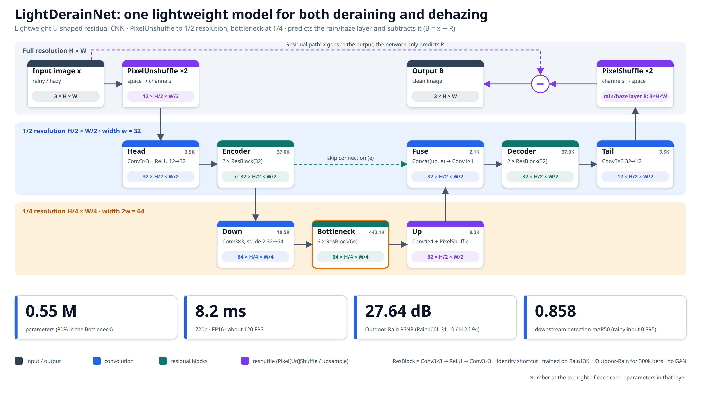

# Derain: One Lightweight Model for Rain and Haze Removal

PyTorch experiment code for real-time image deraining/dehazing on edge-class GPUs (university capstone project): training a lightweight model, knowledge distillation, PSNR/SSIM evaluation, model latency benchmarking, full video-pipeline measurement, and ONNX/TensorRT export. Every result is written to `results/*.jsonl` together with hardware and software versions, so it stays traceable.


## Highlights

**LightDerainNet** is a 0.55M-parameter, non-GAN, U-shaped residual CNN that removes rain **and** haze with a single model and runs a 720p frame in **8.2 ms** (FP16, NVIDIA GB10, batch 1).



- Why it is fast: `PixelUnshuffle` drops the work to 1/2 resolution (about 1/4 of the compute), the bottleneck runs at 1/4 resolution, and the network predicts the rain/haze layer `R` (`B = x - R`). No attention or Transformer blocks.
- Why one model: real weather often has rain and haze together. Cascading a derainer and a dehazer doubles latency and, in our tests, was also less accurate.
- Width and depth are adjustable, which enables structural-compression experiments (w32 -> w16, optional knowledge distillation from the w32 teacher).

## Results

Test sets: **Outdoor-Rain Test1** (750 rain+haze images), **Rain100L/H** (rain only), **RESIDE-6K test** (haze only, 848 pairs). Latency is 720p, batch 1, measured on the same machine for every model. PSNR/SSIM are on the Y channel after 8-bit quantization. The main metric is downstream detection **mAP50**: YOLO11s detections on the clean ground truth act as pseudo-labels, so mAP50 measures how close detection on the restored image is to detection on the clean image (it is a relative metric, not an absolute mAP against human labels).

**Rain and rain+haze models** (official weights unless marked; training data differs between models, so the differences include data distribution, not only architecture):

| Model | Params | 720p latency | Outdoor-Rain mAP50 / PSNR / SSIM | Rain100L PSNR | Rain100H PSNR |
|---|---|---|---|---|---|
| WGWS-Net Setting1 | 7.58M | 1127 ms (FP32) | **0.940** / 30.60 / 0.932 | 23.64 | 14.94 |
| WeatherRemover (outdoor_rain) | 24.3M | 1094 ms | **0.953** / 24.99 / 0.909 | 23.20 | 20.87 |
| Restormer (Rain13K) | 26.1M | 1010 ms | 0.728 / 15.14 / 0.637 | **39.08** | **31.47** |
| TransWeather (retrained on our mixed data, 100k iters) | 38.1M | 54 ms | 0.789 / 25.56 / 0.850 | 28.93 | 25.35 |
| **LightDerainNet w32, mixed 300k (ours)** | **0.55M** | **8.2 ms** | 0.858 / 27.64 / 0.890 | 31.10 | 26.94 |

- Each large model wins on its home test set (WGWS-Net/WeatherRemover on Outdoor-Rain, Restormer on Rain100L/H), but only on that one: Restormer reaches 15.14 dB on rain+haze, WGWS-Net 14.94 dB on heavy rain, WeatherRemover is 8 dB below ours on Rain100L. LightDerainNet is usable on all three.
- Cost: about 140x faster and 14x smaller than WGWS-Net; about 130x faster and 44x smaller than WeatherRemover.
- Against TransWeather retrained on the same data, ours has 1/69 of the parameters and is about 6.6x faster with equal mAP50 and slightly better PSNR.


**Why a single mixed-data model.** Trained only on Rain13K, w32 barely helps on rain+haze (15.15 dB vs 14.46 dB input). Trained only on Outdoor-Rain, it drops to 20.44 dB on Rain100L. Training on Rain13K + Outdoor-Rain (22,711 pairs) covers both: detection mAP50 on Outdoor-Rain goes from 0.395 (rainy input) to **0.858** (recall 0.831). w48 gave similar quality at 16.7 ms, so w32 was kept.

**Cascades are worse.** Deraining (w32/w16) followed by a dehazing model (AOD-Net or UCL-Dehaze) reaches mAP50 0.727/0.690 vs 0.858 for the single model; cascading UCL-Dehaze (GAN) is also about 24x slower (199 ms vs 8.2 ms).

**Pure-haze limitation (honest result).** On RESIDE-6K (input 14.92 dB / 0.818) the model has no dehazing ability: 14.47 dB / 0.783, 0.5 dB below the input and about 6.7 dB below AOD-Net (21.13) and UCL-Dehaze (21.32). On rain+haze they are far behind (mAP50 0.407 / 0.384 vs 0.858) because they do not remove rain streaks. A likely cause (not yet verified) is that the training haze is the thin haze attached to rainy scenes, not atmospheric-scattering haze; adding RESIDE training data is the next step.

**Rain-only baseline (Rain13K, w32, 100k iters, about 31 minutes):** above 30 dB on Rain100L, Test1200 and Test2800; below on Rain100H and Test100. SSIM: Rain100L 0.940, Rain100H 0.847, Test100 0.863, Test1200 0.901, Test2800 0.926. GPU acceleration alone (no model change) takes 720p from about 300 ms on CPU to single-digit ms with FP16 and cuDNN, with PSNR changes below 0.002 dB.

Structural compression (kept as a side experiment): w16 has 1/4 of the parameters (140K) and 1/3.9 of the GFLOPs; PSNR drops by 0.2-2 dB, and distillation from w32 helps mainly on Rain100L (+0.4 dB).

## Roadmap

- Add pure-haze data (RESIDE-6K train) to the mixed training set and re-test on RESIDE-6K.
- Train the remaining baselines (Restormer, WGWS-Net) on the same data to convergence for a fair same-data comparison.
- Measure the end-to-end video pipeline latency, TensorRT FP16/INT8, and a low-end GPU (RTX 3050 4 GB); add DRSformer; multi-seed distillation runs.

## Install

```bash
python3 -m venv .venv && source .venv/bin/activate
pip install torch --index-url https://download.pytorch.org/whl/cu130   # adjust to your CUDA version
pip install -r requirements.txt
```

Training takes a long time; use `tmux` or `nohup`:

```bash
nohup python -m derain.train ... --out runs/light32 > runs/light32.log 2>&1 &
```

Run all commands from the repo root.

> **Path note:** OpenCV on Windows cannot read/write videos at non-ASCII paths. Keep videos and datasets under plain ASCII paths such as `D:\datasets\`. Image I/O already handles non-ASCII paths.

## Modules

| Module | Purpose |
| --- | --- |
| `derain/models.py` | Built-in lightweight model `LightDerainNet` (adjustable width/depth for structural-compression experiments) |
| `derain/data.py` | Paired dataset loading (Rain100L/H, Rain200L/H, Rain1400, SPA-Data, ...; pairs by the number in the file name) |
| `derain/metrics.py` | PSNR and SSIM (default: 8-bit quantized, computed on the Y channel) |
| `derain/train.py` | Training; `--teacher` enables knowledge distillation, `--amp` mixed precision, `--converge` stops once validation PSNR plateaus |
| `derain/evaluate.py` | Test-set quality evaluation; writes a per-image CSV and averages |
| `derain/benchmark.py` | Model forward only: mean/median/p95 latency, FPS, peak GPU memory, GFLOPs |
| `derain/video.py` | Full video pipeline: `sequential` (per-stage timings) and `pipelined` (CPU encode/decode overlapped with GPU inference) |
| `derain/export_onnx.py` | ONNX export for TensorRT `trtexec` |
| `derain/report.py` | Turns results into Markdown tables |
| `derain/synth.py` | Synthetic rain images/videos, **for smoke tests only; do not report these results** |
| `tools/downstream_det.py` | Downstream detection metric (YOLO11s pseudo-labels from clean GT: mAP50, mAP50-95, recall) |
| `tools/compare_sota.py` | Quality + 720p latency of external models (Restormer, TransWeather, WGWS-Net, WeatherRemover) with the same metrics |
| `tools/haze_eval.py`, `tools/cascade_eval.py` | Pure-haze evaluation (RESIDE-6K) and derain->dehaze cascade baselines |
| `tools/visual_compare.py`, `tools/draw_arch.py` | Visual comparison figure; architecture diagram |

## Dataset

Rain13K goes in `../datasets/Rain13K` and is downloaded by `tools/fetch_rain13k.py`.
The source is the unofficial Hugging Face mirror `dronefreak/Rain13K` (license marked unknown); use it for academic purposes only and cite the original papers.
Anonymous downloads run at roughly 4 files per second, about 36,000 files in total, so expect 2-3 hours.

`tools/train_after_download.sh` waits for the download to finish, checks the pair counts, then starts training `runs/light32` automatically.

## Typical workflow

```powershell
# 0. Smoke test (no dataset needed)
python -m derain.synth dataset --out data/smoke --n 40 --size 128
python -m derain.train --train-root data/smoke/train --val-root data/smoke/test --iters 200 --val-every 100 --batch 4 --patch 96 --workers 0 --out runs/smoke

# 1. Train the baseline (Rain200L as an example)
python -m derain.train --train-root D:/datasets/Rain200L/train --val-root D:/datasets/Rain200L/test --amp --out runs/light32

# 2. Quality evaluation (FP32 and FP16, to compare the quality impact of precision)
python -m derain.evaluate --ckpt runs/light32/best.pt --data D:/datasets/Rain200L/test --precision fp32 --tag B-fp32
python -m derain.evaluate --ckpt runs/light32/best.pt --data D:/datasets/Rain200L/test --precision fp16 --tag D-fp16

# 3. Model latency (several resolutions x precisions)
python -m derain.benchmark --ckpt runs/light32/best.pt --size 480x640 720x1280 --precision fp32 fp16 --tag B
python -m derain.benchmark --ckpt runs/light32/best.pt --size 720x1280 --precision fp16 --channels-last --cudnn-benchmark --tag C

# 4. Structural compression: width-16 student + knowledge distillation
python -m derain.train ... --width 16 --teacher runs/light32/best.pt --kd-weight 0.5 --out runs/light16_kd

# 5. Full video pipeline
python -m derain.video --ckpt runs/light32/best.pt --input D:/videos/rain.mp4 --mode sequential --tag V-seq
python -m derain.video --ckpt runs/light32/best.pt --input D:/videos/rain.mp4 --mode pipelined --precision fp16 --output D:/videos/out.mp4 --side-by-side --tag V-pipe

# 6. Summarize into tables
python -m derain.report --results results > results/summary.md
```

## External models (DRSformer, SSDRNet, ...)

External models are not reimplemented here; they are loaded straight from their official repos so they match the published implementation. Example with DRSformer:

```powershell
git clone https://github.com/cschenxiang/DRSformer D:/repos/DRSformer
# download the pretrained weights following that repo's README first
python -m derain.benchmark --ext-repo D:/repos/DRSformer --ext-module basicsr.models.archs.DRSformer_arch --ext-class DRSformer --ext-weights D:/repos/DRSformer/pretrained_models/xxx.pth --size 480x640 --precision fp32 fp16 --tag DRSformer
```

`--ext-kwargs` passes constructor arguments as JSON. Common keys such as `params` and `state_dict` in the weights file are unwrapped automatically.
The external repo may need extra dependencies (see its README). DRSformer can run out of memory at high resolution on 4 GB of VRAM; the run is recorded as `OOM` instead of crashing.

## Measurement rules (state these when reporting)

- **Model latency:** batch=1, fixed size, 20 warm-up runs then 100 timed runs, each timed with CUDA events and synchronized; report median and p95. Excludes file I/O and encode/decode.
- **Full pipeline:** in `sequential`, latency is the time from reading a frame to writing it. In `pipelined`, it is the time from when the frame is read to when it is written, including queueing. Throughput = frames / total time.
  - When testing `pipelined` on a video file, reading is much faster than a real camera, so frames pile up in the queue and latency is overestimated. Use `--pace` to feed frames at the source frame rate to get camera-scenario latency.
  - Measure throughput (maximum processing speed) without `--pace` and latency (camera scenario) with `--pace`; report them separately.
- **Quality:** output is quantized to 8-bit and measured on the Y channel, no border crop by default. Numbers using RGB or a crop are not directly comparable with other settings.
- FP16 changes numeric values, so re-evaluate quality; do not judge by speed alone.
